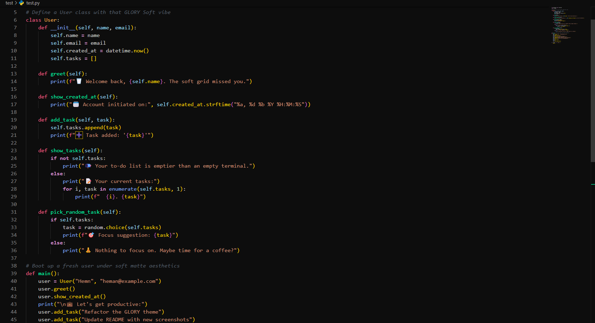
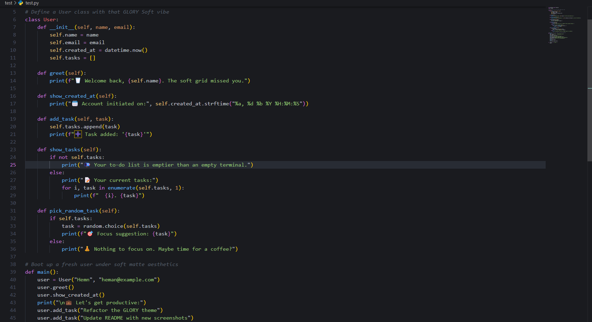

  
  
  
  
  

 

<h1 align="center">🚀 GLORY — Dark Theme for VS Code</h1>

A bold, beautiful, and immersive dark theme family for Visual Studio Code. 
Darker than your coffee. Cleaner than your commit history. 😎

  
  

---

## ✨ Variants

Choose your GLORY:

| Variant            | Preview                        |
|--------------------|--------------------------------|
| 🐍 GLORY Deep       |      |
| 🌙 GLORY Soft       |  |
| 🇮🇷 GLORY Persian    | _Coming soon..._               |
| 🌑 GLORY Dark       | _Coming soon..._               |

> _More flavors coming soon — stay tuned!_ 🎨

---

## ⚙️ Installation

### Method 1: VS Code Marketplace
🔹 Click here → [GLORY on Marketplace](https://marketplace.visualstudio.com/items?itemName=heman-sadeghi.glory-theme)

### Method 2: Inside VS Code

1. Open **Extensions** sidebar (Ctrl+Shift+X)
2. Search for `GLORY Theme`
3. Click **Install**
4. Select your favorite variant via **Command Palette** → `Preferences: Color Theme`

---

## 🌈 Why GLORY?

- 🎨 Modern color palettes for deep focus and style
- 🧠 Carefully tuned contrasts for readability & eye comfort
- 💻 Designed for dark-mode lovers and night coders
- ❤️ Built with love by developers, for developers

---

## 🧑‍💻 Author

Created with ❤️ by [**Heman Sadeghi**](https://github.com/hemansadeghi)

> "GLORY is not just a theme — it’s an attitude."  
> _Coding is an art. Paint it with glory._

---

## 🤝 Contributions Welcome

Pull requests and suggestions are welcome!  
If you have new color variants or tweaks in mind, feel free to:

- Fork the repo
- Open a PR
- Or start a discussion in [Issues](https://github.com/hemansadeghi/glory-vscode-theme/issues)

---

## 📄 License

This project is licensed under the [MIT License](LICENSE)

---

  <strong>💫 Code in style. Choose GLORY.</strong>

